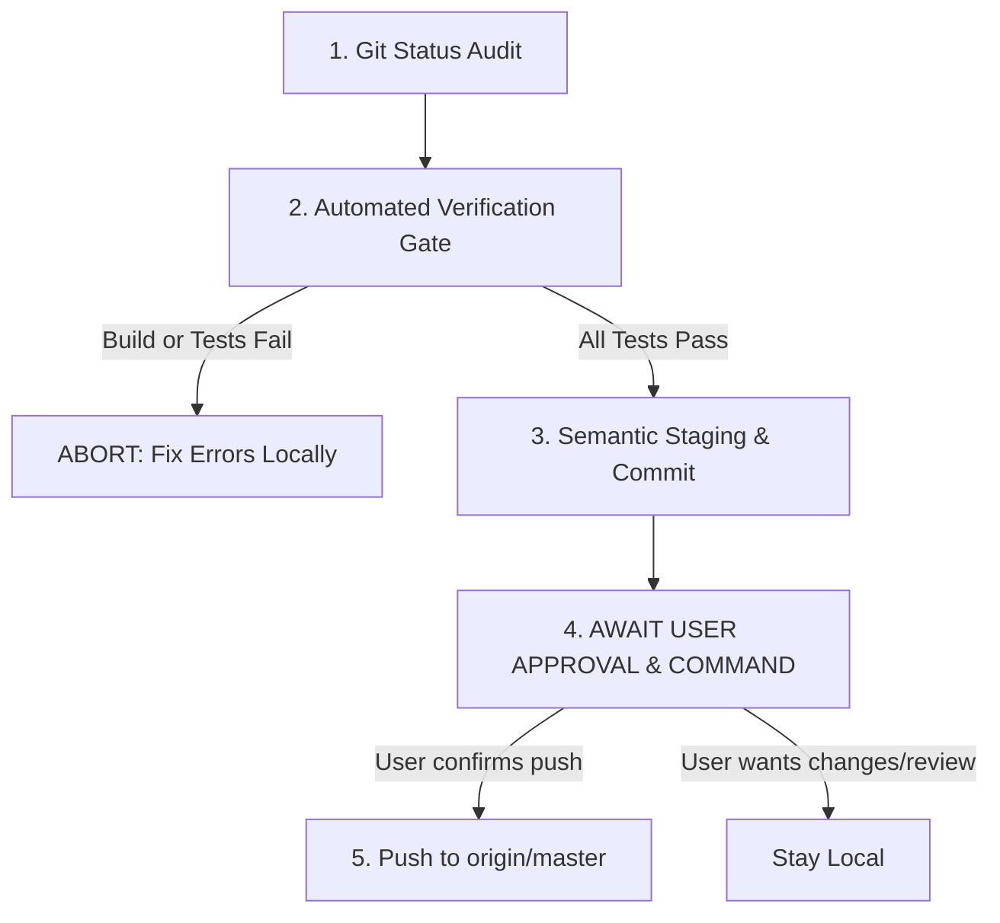

# Git Push with Tests: Production-Grade Verification & Deployment Pipeline

This skill governs the automated testing, verification, staging, committing, and pushing workflow for **OPA Imprimerie**.
It ensures that broken builds, hydration mismatches, iOS WebKit runtime errors, or layout regressions are **never** pushed to GitHub or deployed to production.

---

## 1. When to Activate This Skill

> [!CAUTION]
> **MANDATORY HUMAN APPROVAL RULE:**
> This skill must **ONLY** perform a remote push (`git push`) when the user **explicitly commands** a push. Never push to GitHub autonomously or implicitly after finishing a task or seeing tests pass.

Activate this skill:
- When the user explicitly requests: *"push to github"*, *"push my changes"*, *"commit and push"*, *"push with testing"*, or *"deploy"*.
- For local verification only (`npm run test:verify`), you may run tests locally at any time without pushing.

---

## 2. The Safe Verification & Push Protocol



---

### Phase 1: Working Tree Audit & Diff Inspection

Before touching git, inspect what actually changed to ensure no extraneous debug files, scratch scripts, or unintended credentials are committed.

1. **Check status:**
   ```bash
   git status
   ```
2. **Review diff:**
   ```bash
   git diff --stat
   ```
3. **Verify clean boundaries:**
   - Exclude `.playwright-mcp/` session artifacts or temporary screenshots if not explicitly intended.
   - Ensure `node_modules`, `.next`, and `.env*.local` remain untracked.

---

### Phase 2: Mandatory Automated Verification Gate

> [!IMPORTANT]
> **Zero-Bypass Policy:** Never run `git push` without passing this verification gate. Bypassing tests (`--no-verify`) is strictly prohibited.

Execute the unified verification pipeline:
```bash
npm run test:verify
```
Or directly:
```bash
node scripts/pre-push-verify.mjs
```

#### What `npm run test:verify` Executes:
1. **Full Production Compilation:** Runs `npm run build` (Next.js 15 App Router + React 19). Verifies zero TypeScript type errors, zero ESLint failures, and zero static generation failures.
2. **Ephemeral Production Server:** Starts `next start` on a dedicated test port (`3005`).
3. **iOS WebKit iPhone 11 Smoke Check:**
   - Runs headless Playwright WebKit with `devices['iPhone 11']`.
   - Verifies **zero uncaught exceptions** (`pageerror`).
   - Verifies **zero application errors** (*"Application error: a client-side exception has occurred"*).
   - Verifies **zero horizontal overflow** (`scrollWidth === clientWidth`).
   - Scrolls through all page sections to exercise Framer Motion transforms and GSAP triggers.
4. **Desktop Chromium Smoke Check:**
   - Runs desktop viewport (`1280x800`).
   - Validates responsive rendering and preloader dissolution.
5. **Clean Teardown:** Terminates the test server process automatically upon completion.

---

### Phase 3: Semantic Staging & Conventional Commit

Once (and only once) Phase 2 passes with exit code `0`:

1. **Stage all verified files:**
   ```bash
   git add <modified-files>
   ```
   *(or `git add -A` if all pending changes are verified)*

2. **Compose a Conventional Commit Message:**
   Follow semantic conventions:
   - `feat: <description>` for new user-facing capabilities or sections.
   - `fix: <description>` for bug fixes, iOS WebKit crashes, or hydration repairs.
   - `style: <description>` for typography, glassmorphism, or aesthetic refinements.
   - `perf: <description>` for asset optimization, LCP improvements, or bundle reductions.
   - `chore: <description>` for tooling, config, dependencies, or test additions.

3. **Commit:**
   ```bash
   git commit -m "<type>(<scope>): <concise descriptive message>"
   ```

---

### Phase 4: Remote Push & Deployment Confirmation

1. **Detect Current Branch:**
   ```bash
   git branch --show-current
   ```
2. **Push to GitHub Remote:**
   ```bash
   git push origin <branch>
   ```
3. **Verify Push Success:**
   - Confirm git outputs `master -> master` (or current branch).
   - Verify that Vercel auto-deployment begins building `opa-agency.vercel.app`.

---

## 3. One-Command Automated Shortcut

For convenience, the pipeline can also be run in a single command via the helper script:

```bash
npm run push:safe -- "<optional commit message>"
```
*(This script runs the full `test:verify` gate, commits with the provided message, and pushes to GitHub in one seamless sequence).*

---

## 4. Failure Handling & Recovery Protocols

| Failure Point | Action Required |
| :--- | :--- |
| **TypeScript / Build Error** | Do NOT commit. Read the error line, apply the fix, and re-run `npm run build`. |
| **iPhone 11 WebKit Exception** | Check for duplicate consecutive values in `useTransform` ranges (`NaN`), zero-dimension WebGL canvases, or uncaught `throw` statements. |
| **Horizontal Overflow** | Inspect section wrappers for missing `max-w-full`, fixed pixel widths exceeding 375px, or unconstrained SVG dimensions. |
| **Git Push Rejected** | Pull remote changes first (`git pull --rebase origin <branch>`), re-verify with `npm run test:verify`, then push. |

---

## 5. Documentation Maintenance

Whenever pre-push testing logic or deployment targets are updated:
- Update `scripts/pre-push-verify.mjs` and `scripts/safe-push.mjs`.
- Synchronize `AGENTS.md` (Section 14 & 16).
